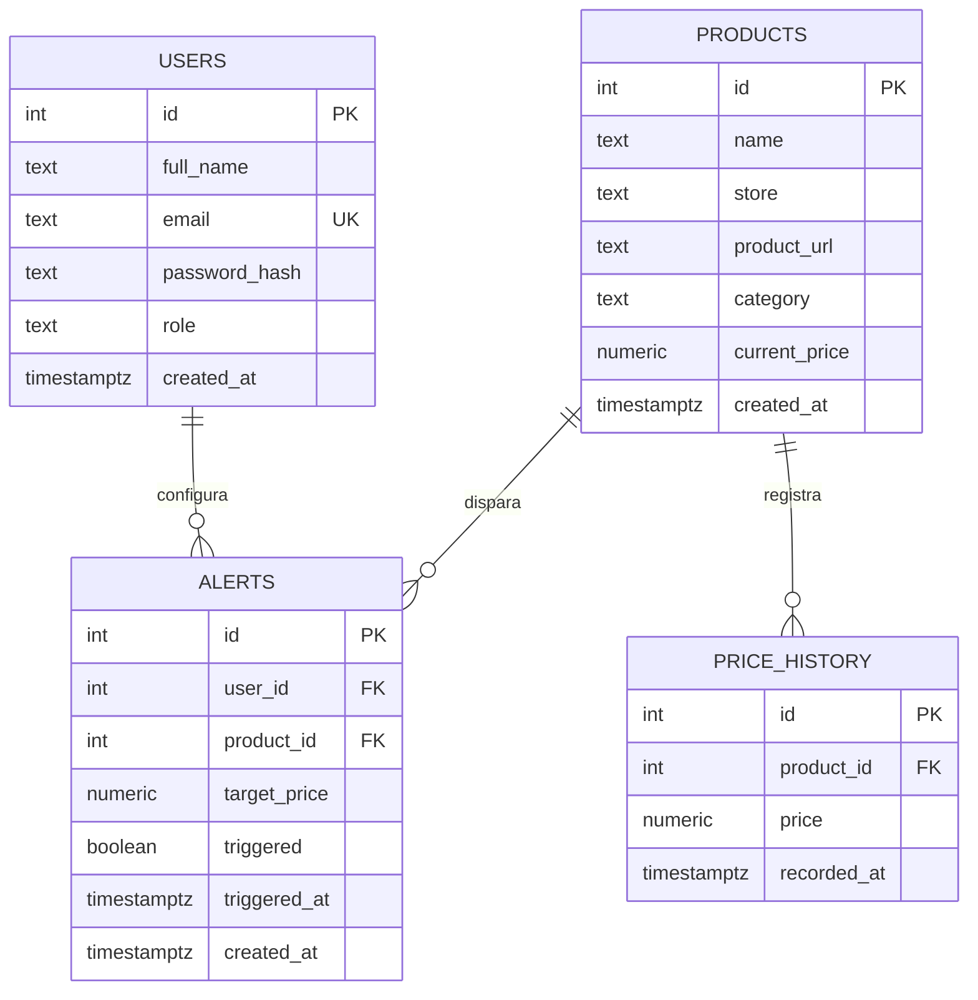

# PRD · Monitor de Precios

> Documento de requisitos del producto (Product Requirements Document).
> Complétalo en el Sprint 0 (historia H0.3) y pide la aprobación del profesor en un Issue.
> Cada requisito funcional (RF) se convierte en un Issue con la plantilla "Historia de usuario".

| Campo | Valor |
| --- | --- |
| Alumno | Leiby Carrillo |
| Proyecto n.º | 39 |
| Sitio de referencia | CamelCamelCamel |
| Compañero revisor | Vicente Castellón |
| URL desplegada | (se completa en el Sprint 5) |

## 1. Problema

Los precios en tiendas en línea cambian constantemente y muchas ofertas aparentes son en realidad subidas previas con descuento falso. Los compradores necesitan una herramienta que registre la evolución histórica de precios de sus productos de interés y les avise automáticamente cuando alcancen un precio objetivo.

## 2. Usuarios

- **Usuario principal:** Comprador / Administrador. Registra productos a monitorear, consulta el histórico de precios, configura alertas por umbral y exporta reportes.
- **Usuario secundario:** Visitante / Usuario estándar. Explora el catálogo de productos monitoreados, consulta mínimos y máximos históricos y gestiona su propia lista de alertas.

## 3. Objetivo y métrica de éxito

Un usuario registra un producto y configura una alerta de precio objetivo en menos de 10 segundos, y el sistema evalúa el umbral y genera la notificación en menos de 200 ms al registrarse una nueva lectura de precio.

## 4. Alcance del MVP

1. Autenticación y control de roles (Administrador y Usuario estándar).
2. Gestión de catálogo de productos monitoreados (nombre, tienda, URL, categoría y precio actual).
3. Registro de histórico de precios con cálculo automático de precio mínimo, máximo y promedio.
4. Gráfico interactivo de serie temporal (Canvas/SVG) con filtro por rango de fechas (7d, 30d, 90d, todo).
5. Sistema de alertas por umbral (precio objetivo) que se activan automáticamente cuando una nueva lectura baja del valor configurado.
6. Exportación e importación del histórico de precios y productos en formato CSV.

### Funcionalidades → carpetas de `src/` (screaming architecture) 

| Funcionalidad | Carpeta |
| --- | --- |
| Usuarios y autenticación | `src/users` |
| Catálogo de productos | `src/products` |
| Histórico y gráficos de precios | `src/price-history` |
| Alertas por umbral y notificaciones | `src/alerts` |
| Exportación e importación CSV | `src/reports` |

## 5. Fuera de alcance

- Scraping automático en tiempo real contra APIs privadas o protegidas por CAPTCHA de tiendas externas.
- Extensión de navegador (Chrome/Firefox).
- Compra automática o integración con pasarelas de pago.

## 6. Requisitos funcionales

| ID | Requisito | Prioridad (alta, media, baja) |
| --- | --- | --- |
| RF-01 | Iniciar sesión y gestionar productos y alertas según el rol del usuario. | Alta |
| RF-02 | Registrar, buscar, editar y eliminar productos en seguimiento con su tienda y categoría. | Alta |
| RF-03 | Registrar nuevas lecturas de precio y actualizar el mínimo, máximo y promedio histórico. | Alta |
| RF-04 | Visualizar la evolución del precio en un gráfico temporal interactivo (Canvas/SVG). | Alta |
| RF-05 | Crear alertas por umbral y marcarlas como disparadas automáticamente cuando el precio baja del objetivo. | Alta |
| RF-06 | Exportar el catálogo y el histórico de precios en formato CSV. | Media |

## 7. Requisitos no funcionales

- Responsive, móvil primero (375 px y 1280 px).
- Lighthouse ≥ 90 en Accesibilidad y Buenas prácticas.
- 0 errores en la consola del navegador.
- Funciona con 10.000 registros sin congelarse.

## 8. Modelo de datos 

## 9. Reto técnico distintivo

Construir un gráfico de serie temporal en Canvas/SVG capaz de renderizar miles de puntos históricos con línea de referencia del precio objetivo (umbral), combinado con un motor de evaluación de alertas que detecta caídas de precio y notifica al usuario sin recalcular toda la base de datos.

## 10. Riesgos y preguntas abiertas

Riesgo: Lecturas de precios duplicadas o en monedas distintas (se mitigará normalizando los montos a una sola moneda base y validando valores positivos).

Pregunta abierta: ¿Una alerta disparada debe desactivarse automáticamente o volver a avisar si el precio sube y vuelve a bajar?
